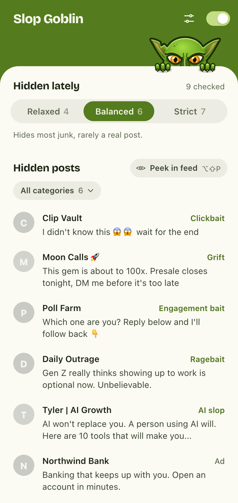

# Slop Goblin

[](https://github.com/joeychilson/slopgoblin/releases/latest)
[](https://github.com/joeychilson/slopgoblin/actions/workflows/ci.yml)
[](LICENSE)

A Chrome extension that hides AI slop, ragebait, clickbait, engagement bait,
reply spam, NSFW posts, grifts and ads from your X feed.

<picture>
  <source media="(prefers-color-scheme: dark)" srcset=".github/screenshots/panel-dark.png">
  
</picture>

Each post you scroll past is judged by Google's
[Gemini Decisions API](https://aistudio.google.com/docs/decisions-api), with
your own API key. A hidden post folds into a slim bar that says why. Click it
to see the post.

## What it does

- Hides seven kinds of junk, ads, and posts X labels "Made with AI". Switch
  off any you don't mind. What X labels itself is hidden without asking Google.
- Three strictness levels. On an everyday feed, Balanced catches over 3 in 4
  junk posts and hides about 1 real post in 300 by mistake.
- Leaves your own posts, people you follow (apart from their ads) and
  accounts you mark "Always show" alone, and never asks Google about them.
- Lists what's been hidden lately in a side panel, from every tab, where you
  can let a post through or always show its author.
- Peek (<kbd>Alt+Shift+P</kbd>) shows hidden posts in place, with a label,
  so you can check the goblin's work.
- Reads X's community notes as evidence about a post.

## Install

Slop Goblin needs Chrome 123 or later.

1. Add it from the
   [Chrome Web Store](https://chromewebstore.google.com/detail/slop-goblin/chfckcjkfehffpammliepgeehalndggk).
2. Click the goblin in Chrome's extensions menu to open the side panel, and
   paste a key from [Google AI Studio](https://aistudio.google.com/apikey).

## What it costs

A free key works. Its 50,000 tokens a minute cover about 50 posts a minute,
and when they run out, the posts on screen are checked first once they're
back. A paid key costs about 10¢ per 1,000 posts. Settings shows this
month's total.

## Privacy

Posts you scroll past are sent to Google with your key, and nothing goes
anywhere else. There's no server, account or telemetry.
[PRIVACY.md](PRIVACY.md) says exactly what's sent and what's kept.

## Development

The extension is in `extension/`, and its website, slopgoblin.app, is in
`site/`.

```sh
pnpm install
vp -C extension build     # into extension/dist/, for Load unpacked
vp -C extension run dev   # rebuild on change
vp -C site dev            # the website
vp check                  # format, lint and type check
vp test
vp run e2e                # the extension in Chromium, on a mock X page
```

[docs/development.md](docs/development.md) has how it works, how the filter
is tuned and measured, how to add a site, how the website is built, and how
to release.

## Report a problem

Open an [issue](https://github.com/joeychilson/slopgoblin/issues/new/choose).
For a post that was judged wrong, use the **Wrong call** form. Report a
security problem privately, as [SECURITY.md](SECURITY.md) says.

## License

[MIT](LICENSE)
